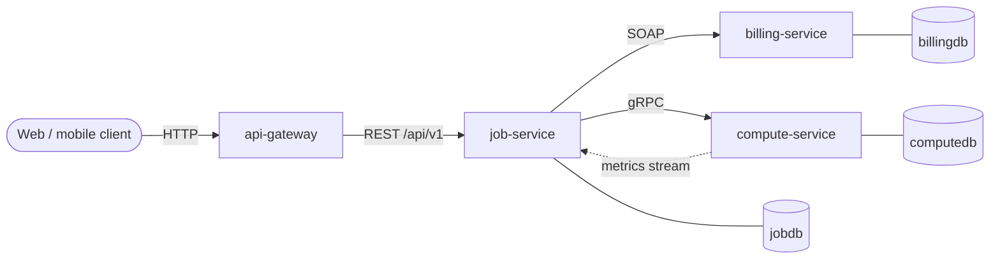
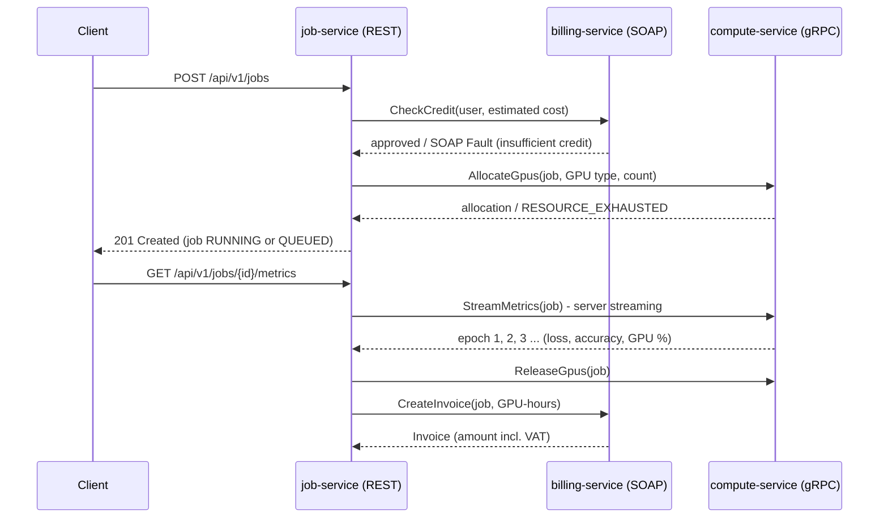

# GPUForge

**A cloud platform for renting GPUs to train AI models, built as microservices that talk to each other over REST, gRPC and SOAP.**

Mini-project for the *Architecture SOA et Services Web* course (2026).
Java 17 · Spring Boot 3.3 · Spring Cloud Gateway · gRPC · Spring-WS · PostgreSQL · Docker Compose

> **Status:** 🚧 in progress. The foundations are done (project structure, service contracts, Docker setup). The business logic is being implemented. See the [Roadmap](#roadmap).

---

## The idea

Training AI models takes powerful GPUs, and most teams don't own any. GPUForge lets a user **rent GPUs by the hour** (NVIDIA A100, H100 or RTX 4090):

1. The user **submits a training job**: which model, which dataset, how many GPUs of which type, and how many epochs.
2. The platform **checks that the user can afford it**, then **allocates the GPUs**.
3. The user **follows the training live**: loss, accuracy, GPU usage and temperature, epoch by epoch.
4. When the job ends, the GPUs are released and the user gets an **invoice** for the GPU-hours used, including VAT.

> Training is **simulated**. Instead of running a real model, the compute service produces realistic metrics (loss goes down, accuracy goes up, GPUs warm up), so the whole platform runs on an ordinary laptop.

---

## Architecture



Each service owns its data. All three databases live in a single PostgreSQL container, but no service ever reads another service's database.

### The services, and why each one uses its protocol

| Service | Protocol | Responsibility | Why this protocol |
|---|---|---|---|
| **api-gateway** | HTTP (Spring Cloud Gateway) | Single entry point: routing, timeouts, and later security | Clients see one stable address, whatever happens behind it |
| **job-service** | **REST** | Public API: users submit, follow, cancel and list their training jobs | REST is the standard for web and mobile clients: resource URLs, HTTP verbs and status codes, an OpenAPI spec, and any client can call it |
| **compute-service** | **gRPC** | Internal GPU scheduler: allocates and releases GPUs, streams training metrics live | Internal, high-frequency traffic. gRPC gives compact binary messages, **streaming** over HTTP/2, a strictly typed `.proto` contract and built-in **deadlines** |
| **billing-service** | **SOAP** | Credit checks and invoices (price × GPU-hours + 19 % VAT) | Simulates a **legacy e-invoicing partner**, like the XML-based national e-invoicing systems invoices must go through. Systems like that expect strict XSD-validated XML contracts and SOAP Faults |

### What happens when a job is submitted



---

## Service contracts

The contracts are written **before** the code (contract-first). Java classes are generated from them at build time.

| Style | Contract | Operations |
|---|---|---|
| SOAP | [`billing.xsd`](billing-service/src/main/resources/xsd/billing.xsd). The WSDL is generated from it and served at `/ws/billing.wsdl` | `CheckCredit`, `CreateInvoice`, `GetInvoice`, plus a SOAP Fault for each operation |
| gRPC | [`compute.proto`](compute-service/src/main/proto/gpuforge/compute/v1/compute.proto) (package `gpuforge.compute.v1`) | `AllocateGpus` (unary), `ReleaseGpus` (unary), `StreamMetrics` (server streaming) |
| REST | OpenAPI, generated and served at `/v3/api-docs` | `/api/v1/jobs` and related resources *(in progress)* |

---

## Getting started

### Prerequisites

- [Docker Desktop](https://www.docker.com/products/docker-desktop/) (with Docker Compose v2). That's all you need to **run** the project.
- For development only: JDK 17. Maven is **not** required, because the included Maven Wrapper (`./mvnw`) downloads it automatically.

### Run everything

```bash
git clone https://github.com/Qznad/gpuforge.git
cd gpuforge
cp .env.example .env        # then choose your own database password
docker compose up --build
```

The first build takes a few minutes while Maven downloads dependencies. The services start in order: PostgreSQL, then billing and compute, then job-service, then the gateway. Each one waits for the previous ones to report healthy.

### Check that it works

```bash
curl http://localhost:8080/actuator/health          # gateway  -> {"status":"UP",...}
curl http://localhost:8083/ws/billing.wsdl          # generated SOAP WSDL
grpcurl -plaintext localhost:9090 list              # gRPC services (reflection enabled)
```

### Ports

| Service | URL |
|---|---|
| api-gateway | http://localhost:8080 |
| job-service (REST) | http://localhost:8081 · Swagger UI: http://localhost:8081/swagger-ui.html |
| compute-service (gRPC) | `localhost:9090` · health: http://localhost:8082/actuator/health |
| billing-service (SOAP) | http://localhost:8083/ws · WSDL: http://localhost:8083/ws/billing.wsdl |

### Build and test without Docker

```bash
./mvnw clean verify          # Windows: mvnw.cmd clean verify
```

### Configuration

All settings come from **environment variables** (see [`.env.example`](.env.example)). No password or secret is stored in the repository. The `.env` file is git-ignored.

---

## Project structure

```
gpuforge/
├── api-gateway/          Spring Cloud Gateway - single entry point
├── job-service/          REST API (+ gRPC and SOAP clients)
├── compute-service/      gRPC server - src/main/proto holds the .proto contract
├── billing-service/      SOAP server - src/main/resources/xsd holds the XSD contract
├── docker/postgres/      Database initialisation (one database per service)
├── docker-compose.yml    Whole platform: network, volumes, healthchecks, startup order
├── .env.example          Configuration template
└── pom.xml               Parent Maven build (shared versions)
```

Each service has its own multi-stage `Dockerfile`: it builds with Maven, then runs on a small JRE image as a non-root user.

---

## Roadmap

### Phase 0 - Foundations ✅
- [x] Maven multi-module project (Java 17, Spring Boot 3.3)
- [x] SOAP contract (`billing.xsd`) written before any code; WSDL generated from it
- [x] gRPC contract (`compute.proto`), versioned as `v1`
- [x] Multi-stage Dockerfiles and Docker Compose (dedicated network, volume, healthchecks, startup order)
- [x] Configuration from environment variables, Actuator health endpoints

### Phase 1 - billing-service (SOAP)
- [ ] Credit accounts and invoices stored in PostgreSQL
- [ ] `CheckCredit`, `CreateInvoice`, `GetInvoice` endpoints
- [ ] Pricing per GPU type, 19 % VAT, Tunisian tax ID (*matricule fiscal*) validation
- [ ] SOAP Faults: insufficient credit, unknown user, invalid tax ID, invoice not found
- [ ] Unit tests and an integration test

### Phase 2 - compute-service (gRPC)
- [ ] GPU inventory (nodes per GPU type) and allocations
- [ ] `AllocateGpus` / `ReleaseGpus` with meaningful status codes (`RESOURCE_EXHAUSTED`, `NOT_FOUND`, ...)
- [ ] Training simulator and `StreamMetrics` server streaming
- [ ] Unit tests and an integration test

### Phase 3 - job-service (REST)
- [ ] `/api/v1/jobs` resources: submit, get, list, cancel
- [ ] Input validation and centralised error handling (`@RestControllerAdvice`)
- [ ] OpenAPI documentation
- [ ] Unit tests and an integration test

### Phase 4 - Integration and resilience
- [ ] job-service calls billing-service over SOAP (`WebServiceTemplate`)
- [ ] job-service calls compute-service over gRPC, with a client deadline
- [ ] Explicit timeouts on every network call
- [ ] Resilience4j circuit breaker and retry with backoff, plus a fallback (job kept as `PENDING_BILLING` / `QUEUED`)
- [ ] Simulated failure demo: stop a service and show the fallback

### Phase 5 - Delivery
- [ ] Gateway routes for the whole public API
- [ ] Postman collection and `curl` / `grpcurl` scripts covering the main scenarios
- [ ] Lighter Docker images
- [ ] Final README with call examples, and the project report

### Stretch goals
- [ ] CI pipeline (GitHub Actions) building and testing on every push
- [ ] Integration tests against a real PostgreSQL with Testcontainers
- [ ] Asynchronous `JobCompleted` event (Kafka or RabbitMQ)
- [ ] JWT authentication on the gateway
